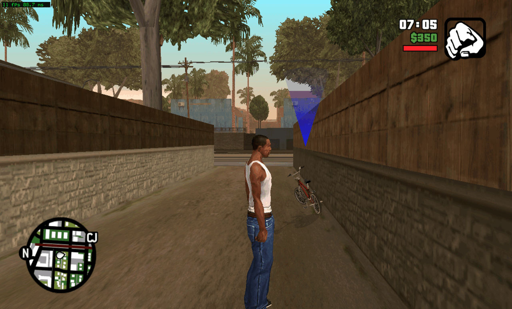

<p align="center">
  
</p>

# Project Grove (work in progress)

**Grand Theft Auto: San Andreas (PS3): unofficial PC port (static recompilation)**


**[Status](#status)** · **[Features](docs/FEATURES.md)** · **[Screenshots](docs/SCREENSHOTS.md)** ·
**[Requirements](docs/requirements.md)** · **[Getting your files](docs/GETTING-FILES.md)** ·
**[Building](docs/BUILDING.md)** · **[How it works](docs/HOW-IT-WORKS.md)** · **[Known issues](docs/KNOWN_ISSUES.md)** ·
**[Roadmap](docs/ROADMAP.md)** · **[AI use](#how-ai-was-used)** · **[Contributing](.github/CONTRIBUTING.md)**

*Grove* is the street in Los Santos where San Andreas opens. Project Grove is a fan project, not official and not
affiliated with or endorsed by Sony Interactive Entertainment or Rockstar Games.

**What this is:** a static recompilation of **Grand Theft Auto: San Andreas** for PS3 (title **BLES02219**, Europe,
v01.02), a port of the War Drum Studios mobile-derived release. The game's PowerPC (PPU) code is translated to C++
ahead of time and compiled into a native Linux x64 program. It is **not an emulator** (no CPU emulator runs at play
time) and **not a rewrite** (the game's logic is the game's own code). Around that code, the PS3's system libraries
are reimplemented and the game's graphics commands are replayed on Vulkan.

**You need your own copy of the game.** This repository contains only the port: source code, patches, tools and
documentation. It contains no game code, data, assets, keys or firmware, and it never will. Each player translates
and builds the game's code on their own machine, from their own files.

## Status

As of 2026-11-10, on Linux x64 with an NVIDIA RTX 4060 Laptop GPU, the maintainer's machine:

| | |
|---|---|
| Code translation | the whole EBOOT is translated: **20,082 PPU functions**, 116 imports, all resolved. No SPU code to lift: this title is PPU + RSX only |
| Boot | the title boots, registers its system modules and mounts its disc through the VFS |
| Menus and movies | the legal screen, the title screen and the intro cutscene play |
| Gameplay | **in game at Grove Street**, with the full HUD (clock, money, health, radar). 11 to 26 fps by scene, under Xvfb |
| Sound | not yet: this container has no audio device, so `cellAudio` opens nothing. Untested with a real one |
| Saves | not yet reached |

What works and what does not, item by item: [docs/FEATURES.md](docs/FEATURES.md). Open problems:
[docs/KNOWN_ISSUES.md](docs/KNOWN_ISSUES.md).

## Getting it

There is no release yet. From a clone:

```sh
git clone <this repository> gta-sa-port
cd gta-sa-port
tools/install.sh     # asks where your files are, checks them, lifts and builds
tools/play.sh        # plays in a window
```

You need:

- your own **Grand Theft Auto: San Andreas** PS3 disc (BLES02219) and a decrypted `EBOOT.elf` from it, plus the four
  data archives from `PS3_GAME/USRDIR/` (`PS3DataMain.obb`, `PS3Data.obb`, `PS3DataText.zip`, `PS3DataText2.zip`
  and their `.idx`). What each must be is in [docs/GETTING-FILES.md](docs/GETTING-FILES.md);
- Linux x64 with clang, CMake, Ninja, Python 3 and the Vulkan headers;
- a CPU with AVX2 (x86-64-v3) and a Vulkan GPU.

## How it works, briefly

- **PPU:** the game's PowerPC functions are lifted to C++ ahead of time and compiled with clang.
- **SPU:** nothing to lift. This title imports no `cellSpurs` and ships no SPU programs; the pipeline accepts an
  empty block manifest and still produces its registry.
- **Graphics:** the game's RSX command stream is replayed on Vulkan.
- **Data:** the game reads its own archives through its own file system code. They are ordinary stored ZIP files and
  the runtime only serves the bytes; the title does its own parsing through the paired `.idx`.

More: [docs/HOW-IT-WORKS.md](docs/HOW-IT-WORKS.md).

## How AI was used

This project is developed with AI coding agents. The agents did most of the work of reading the game's binary and
reference material, writing and testing patches, tools and documentation, and running the builds, with the maintainer
setting the goals, playing and checking the game, and deciding what is published. Findings are dated. An
`ASSUMPTION:` in the code or the docs is not fact. If you find a statement here that was not verified, please open an
issue.

## Related projects

- [Project Vekta](https://github.com/gustavomorinaga/project-vekta) (Killzone HD), and through it
  [Project Helghast](https://github.com/undecuple/project-helghast) and
  [Project Pyrrhus](https://github.com/undecuple/project-pyrrhus): the model for this repository's layout. Credits:
  [NOTICE.md](NOTICE.md).
- [ps3base](https://github.com/snuri00/GoWA-pc), the generic PS3 static-recompilation runtime this port's runtime is
  forked from.

## Repository layout

| Path | What it holds |
|---|---|
| `port/grove/` | the program: boot, HLE overrides, the runtime patches this title needs |
| `port/patches/` | numbered patches to the runtime, and `series`, the order they apply in |
| `tools/` | lift, build, run and check scripts |
| `docs/` | the public documentation |

## Licence

The port is MIT ([LICENSE](LICENSE)): that licence covers the port only, its code, patches, tools and documentation.
Third-party parts and credits are in [NOTICE.md](NOTICE.md). Grand Theft Auto and Grand Theft Auto: San Andreas are
trademarks of Take-Two Interactive Software, Inc.; nothing of the game is licensed or included here.
