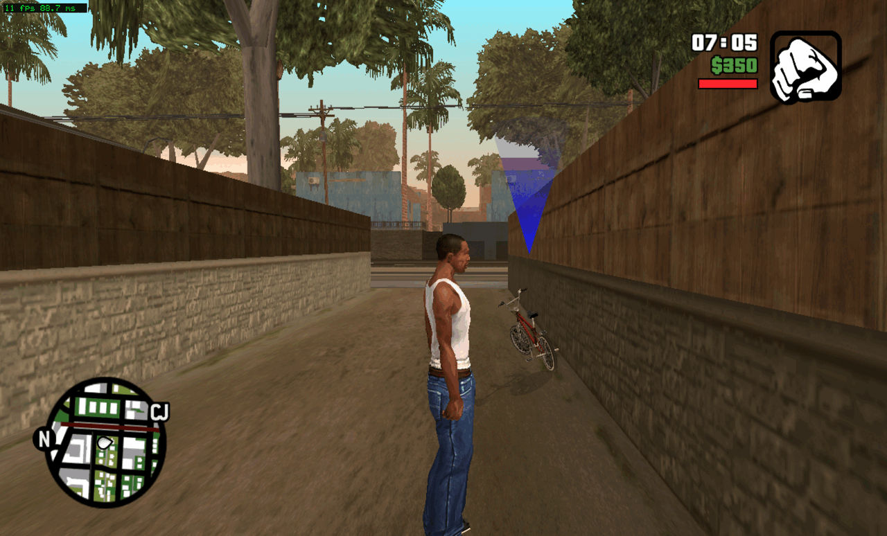
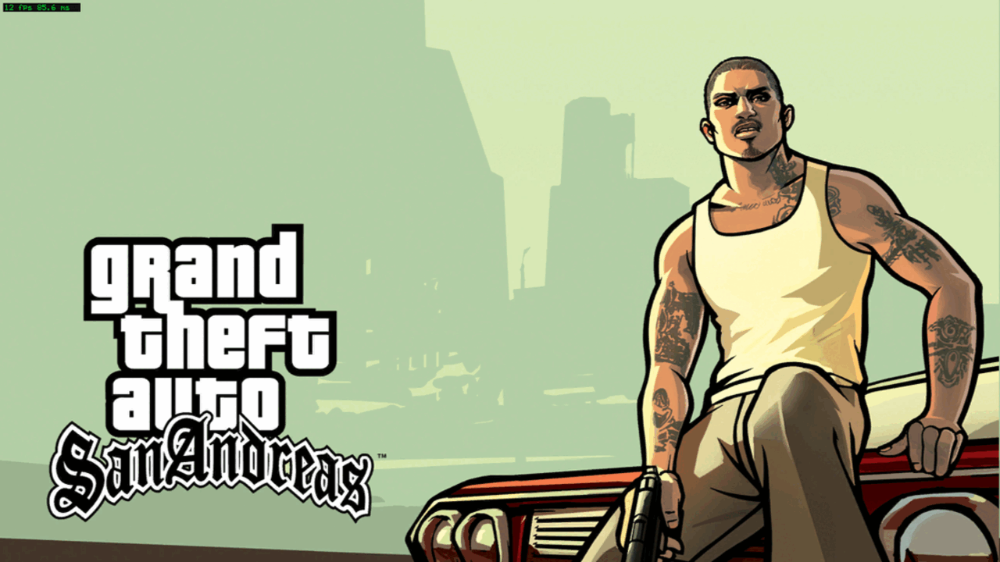

# Screenshots

All taken from the port running on Linux x64, NVIDIA RTX 4060 Laptop GPU, presented through Xvfb (software
presentation, which is why the frame counter reads 11 to 26 fps; that is not the renderer's ceiling).

## Grove Street, in game

The opening location, with the HUD the title draws for itself: clock (07:05), money ($350), the health bar, the radar
in the corner, and the marker above the BMX. The blue triangular artefact beside the BMX is a known issue, recorded in
[KNOWN_ISSUES.md](KNOWN_ISSUES.md) rather than cropped out.

Earlier in the same session: the title screen, the game's own artwork and logo, with the "press a button to continue"
prompt drawn by the title itself.

## What these do not show

Audio. This machine has no sound device, so `cellAudio` initialises and produces nothing. A screenshot cannot settle
whether the game's mixer is correct, and no claim is made here that it is.
